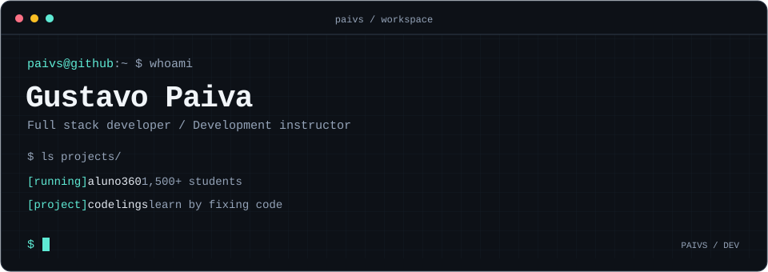

[English](README.md) / [Português](README.pt-BR.md)

Desenvolvo software e ensino desenvolvimento no **SENAI**. Já trabalhei com redes e infraestrutura, além de desenvolver software industrial. Hoje, meu trabalho está em aplicações web e ferramentas para aprender a programar.

### 🧰 `~/tecnologias`

### 📂 `~/projetos`

🎓 **[Aluno360](https://github.com/Paivs/Aluno360)** · em produção

Desenvolvi e mantenho o sistema usado na unidade do SENAI onde leciono. **Mais de 1.500 alunos são administrados pela plataforma**: turmas, carômetro, contatos de responsáveis e registros de incidentes. Cuido do frontend, da API, do banco de dados e do ambiente de produção.

🔐 LDAP / Active Directory

⌨️ **[Codelings](https://github.com/Paivs/codelings)** · programação pelo terminal

Aprenda a programar corrigindo código e completando exercícios. Desenvolvi o motor em Python, com suporte a nove linguagens, retorno automático ao salvar, acompanhamento de progresso e sincronização de exercícios de repositórios remotos.

🛠️ CLI / Ferramentas para devs · [Site](https://codelings.dev)

📅 **[Liszt](https://github.com/Paivs/Liszt)** · desenvolvimento web full stack

Plataforma de psicoterapia para gerenciar sessões, agendamentos e diários de emoções e sonhos. Desenvolvi o frontend, o backend e a infraestrutura.

### 🔎 `~/proximos-passos`

Quero integrar IA às aplicações que desenvolvo. É a próxima área que pretendo explorar com um projeto funcionando.

### ✉️ `~/contato`

[gustavo.paiva.gp1@gmail.com](mailto:gustavo.paiva.gp1@gmail.com)
